# Set up a Discord bot

This guide creates a Discord application with a bot user, turns on the gateway intents Chatom needs, invites the bot to a server, and checks the connection with Chatom's examples. You need the **Manage Server** permission on the server.

## Create the application

Open the [Discord Developer Portal](https://discord.com/developers/applications) and select **New Application**.

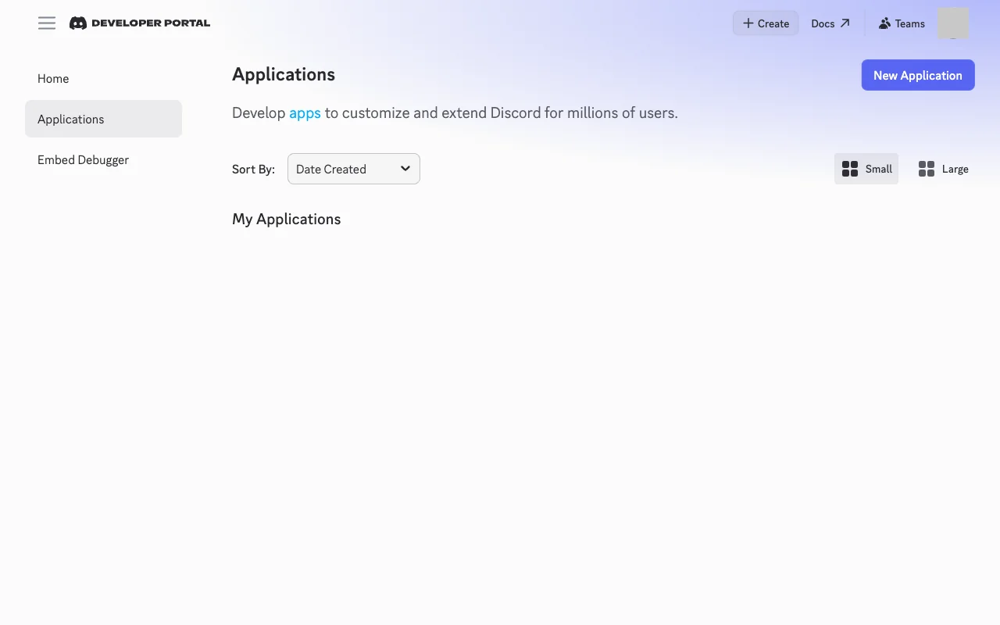

Name the application, accept the terms, and select **Create**.

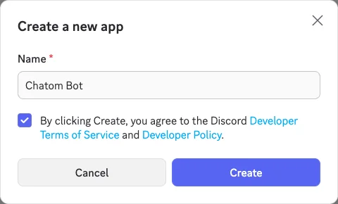

The portal opens **General Information**. Note the **Application ID**; the invite link below needs it.

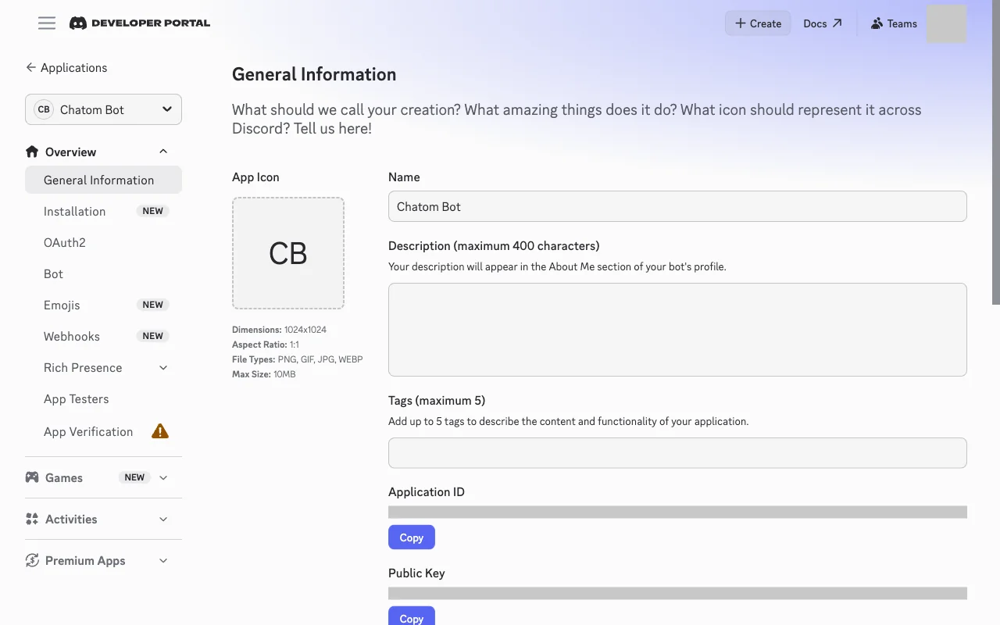

## Copy the bot token

Open **Bot** in the sidebar. Set the bot's username if you want one that differs from the application name, then select **Reset Token** and copy the token into your secret store. Discord shows it only once; if you lose it, reset it again.

Turn off **Public Bot** unless other people should be able to add your bot to their servers.

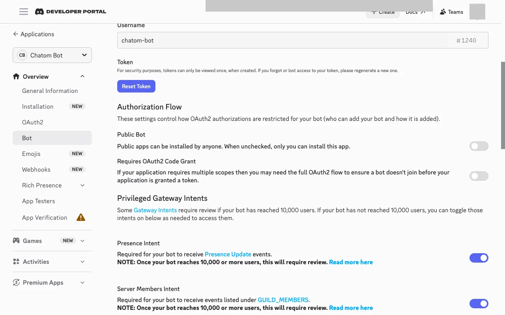

## Turn on the privileged intents

Further down the **Bot** page, under **Privileged Gateway Intents**:

- **Message Content Intent** is required. Without it, Discord delivers messages that don't mention the bot with empty content.
- **Server Members Intent** lets the bot list the server's members, which helps when looking up users by name. Add `members` to the config's intents to use it.
- **Presence Intent** lets the bot read other users' presence. Add `presences` to the config's intents to use it.

Select **Save Changes**.

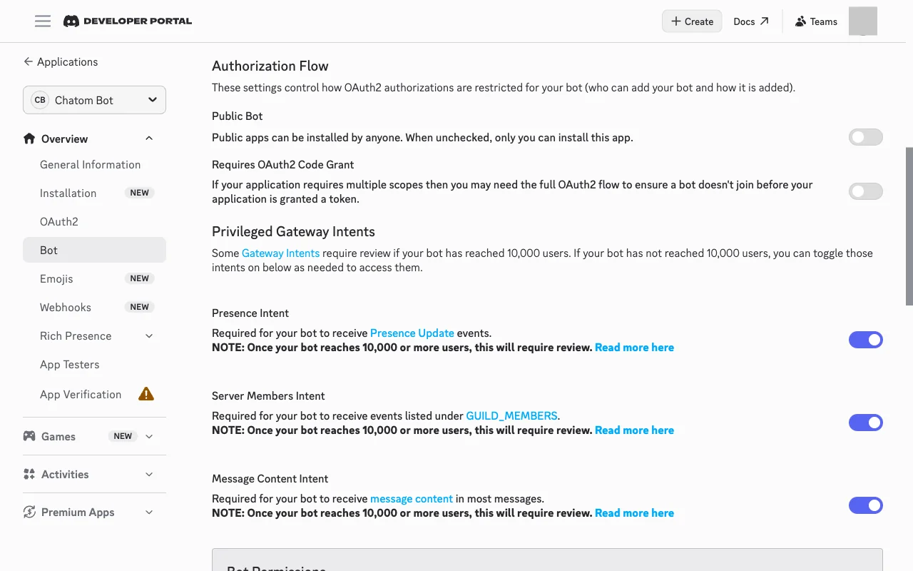

## Invite the bot to a server

Open this link with your application ID in place of `APPLICATION_ID`:

```text
https://discord.com/oauth2/authorize?client_id=APPLICATION_ID&scope=bot&permissions=309237763136
```

The `permissions` value grants View Channels, Send Messages, Send Messages in Threads, Create Public Threads, Embed Links, Attach Files, Read Message History, and Add Reactions. To choose different permissions, build the link under **OAuth2** → **OAuth2 URL Generator** with the `bot` scope.

Pick the server and select **Continue**.

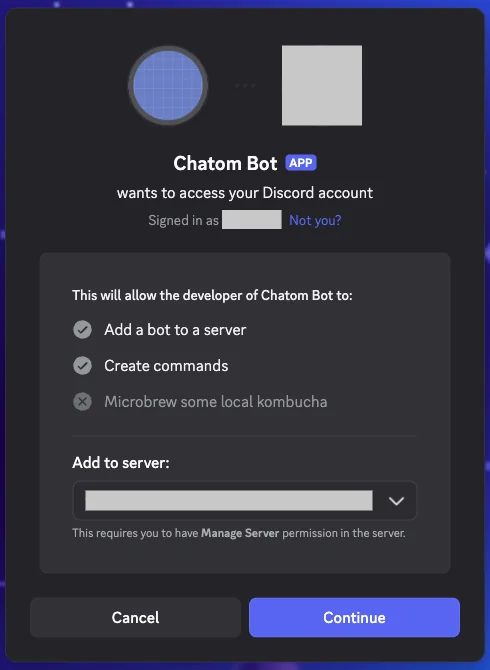

Confirm the permissions and select **Authorize**.

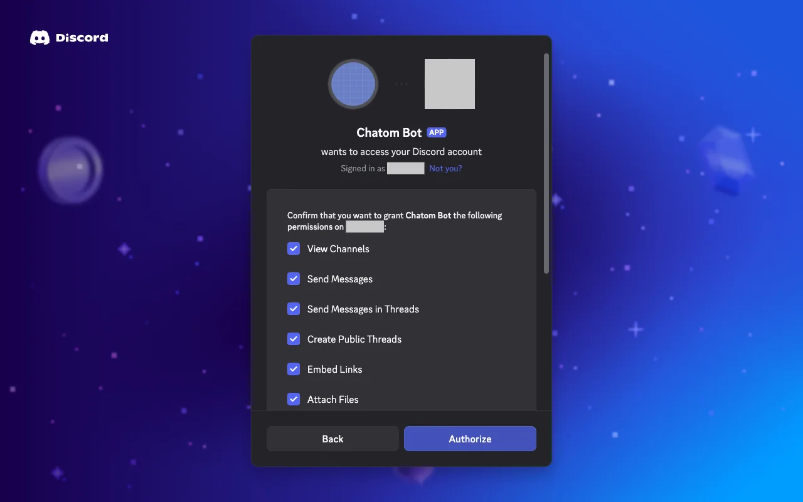

## Give the bot access to private channels

The bot can see every public channel on the server. A private channel only shows to the members and roles it lists, so add the bot to any private channel it should use: open the channel's settings, go to **Permissions**, select **Add members or roles**, and pick the bot.

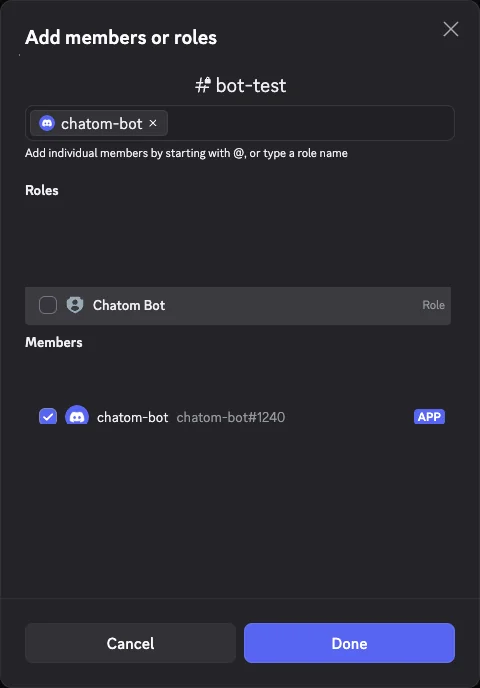

The bot then appears under **Members**.

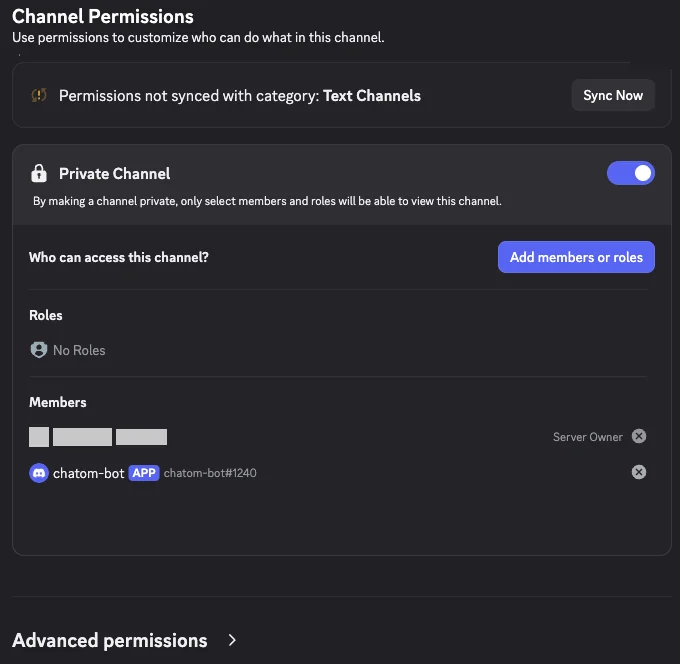

## Connect with Chatom

```bash
pip install chatom discord.py
```

Request the `message_content` intent in the config as well as in the portal:

```python
import os

from chatom.discord import DiscordBackend, DiscordConfig

backend = DiscordBackend(
    config=DiscordConfig(
        token=os.environ["DISCORD_TOKEN"],
        guild_id=os.environ["DISCORD_GUILD_ID"],
        intents=["guilds", "guild_messages", "message_content"],
    )
)
```

`guild_id` is the server to search when looking up channels and users by name. If the config requests a privileged intent that is switched off in the portal, Discord refuses the gateway connection.

## Check the setup

Chatom's examples look up the server by name. Set these variables and run the examples from a shell:

```bash
export DISCORD_TOKEN=...
export DISCORD_GUILD_NAME="My Server"
export DISCORD_TEST_CHANNEL_NAME=bot-test

python -m chatom.examples.basic_connection --backend discord
python -m chatom.examples.send_message --backend discord
python -m chatom.examples.listen_for_messages --backend discord --timeout 60
```

`basic_connection` prints the backend's capabilities and the servers the bot belongs to. `send_message` posts a greeting in the channel:

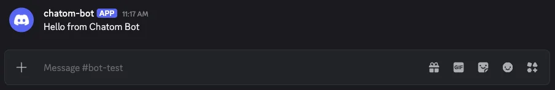

While `listen_for_messages` runs, send `!ping`, `!help`, or `!dm` in the channel. The bot answers each one, and `!dm` arrives as a direct message.

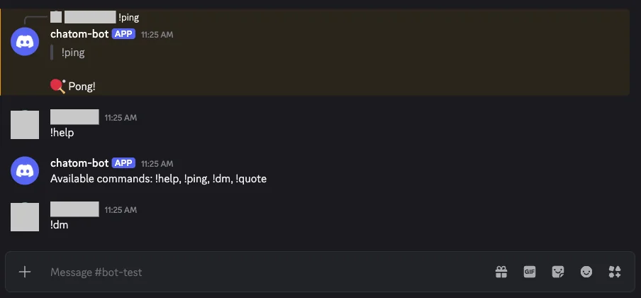
