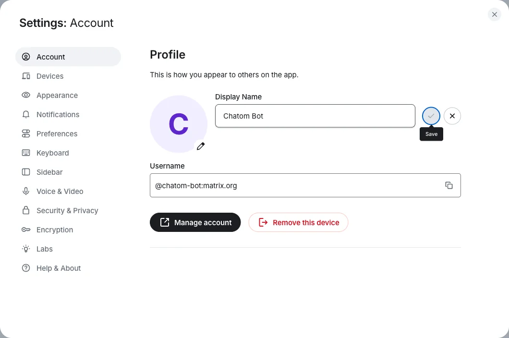
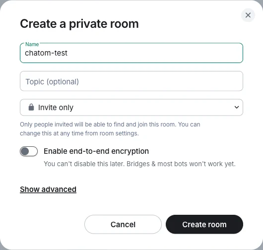
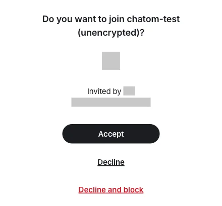

# Set up a Matrix bot

Matrix has no separate bot accounts: a bot is an ordinary user. This guide registers that user on matrix.org, gets an access token for it, puts it in an unencrypted room, and checks the connection with Chatom's examples. Any homeserver works the same way; replace `matrix.org` with yours.

## Create the account

Open [Element](https://app.element.io/#/register) in a private browser window, so you stay signed in to your own account elsewhere, and select **Create account**. Keep `matrix.org` as the host or pick your homeserver, then choose the bot's username and password and finish the server's sign-up steps.


Open **Settings** → **Account** and set a **Display Name**, which is how the bot appears in rooms.



## Get an access token

Log in once through the client-server API to get a token tied to its own device. Choosing the `device_id` keeps later logins on the same device instead of adding a new one each time:

```bash
curl -s -X POST https://matrix-client.matrix.org/_matrix/client/v3/login \
  -H "Content-Type: application/json" \
  -d '{
    "type": "m.login.password",
    "identifier": {"type": "m.id.user", "user": "chatom-bot"},
    "password": "<password>",
    "device_id": "CHATOMBOT",
    "initial_device_display_name": "chatom"
  }'
```

Keep the `access_token` from the response in your secret store, along with the `device_id`. A token from Element's own **Help & About** page also works, but it belongs to that browser session and stops working when you sign out of Element.

## Put the bot in an unencrypted room

Chatom's `MatrixBackend` only works in unencrypted rooms. In Element, signed in as yourself, create a room and switch off **Enable end-to-end encryption** before selecting **Create room**. Encryption cannot be turned off afterward.



Invite the bot from the room's composer:

```text
/invite @chatom-bot:matrix.org
```

The bot does not accept invites by itself. Sign in to Element as the bot and select **Accept**.



Copy the room id from the room's **Settings** → **Advanced**. The examples take the id, or an alias such as `#chatom-test:matrix.org` if the room has one.

## Connect with Chatom

```bash
pip install chatom matrix-nio
```

```python
import os

from chatom.matrix import MatrixBackend, MatrixConfig

backend = MatrixBackend(
    config=MatrixConfig(
        homeserver="https://matrix.org",
        user_id="@chatom-bot:matrix.org",
        access_token=os.environ["MATRIX_ACCESS_TOKEN"],
        device_id="CHATOMBOT",
    )
)
```

`device_id` is required with an access token. You can pass `password` instead of a token, and Chatom logs in when it connects; set `device_id` then too, or each run adds a device to the account.

## Check the setup

```bash
export MATRIX_HOMESERVER=https://matrix.org
export MATRIX_USER_ID=@chatom-bot:matrix.org
export MATRIX_ACCESS_TOKEN=...
export MATRIX_DEVICE_ID=CHATOMBOT
export MATRIX_TEST_ROOM='!roomid'
export MATRIX_TEST_USER_ID=@you:matrix.org

python -m chatom.examples.basic_connection --backend matrix
python -m chatom.examples.send_message --backend matrix
python -m chatom.examples.listen_for_messages --backend matrix --timeout 60
```

`send_message` posts a greeting in the room. While `listen_for_messages` runs, send `!ping`, `!help`, or `!dm` in the room and the bot answers.


