# Set up a Slack bot

This guide creates a Slack app with a bot user, collects the two tokens Chatom needs, adds the bot to a channel, and checks the connection with Chatom's examples. You need permission to install apps in the Slack workspace.

The app uses [Socket Mode](https://docs.slack.dev/apis/events-api/using-socket-mode), so Slack delivers events over a WebSocket that Chatom opens. The bot needs no public URL.

## Create the app from a manifest

Open [api.slack.com/apps](https://api.slack.com/apps) and select **Create New App**.

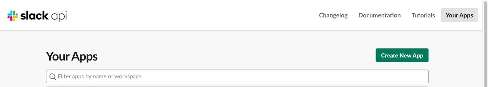

Choose **Paste a manifest**, then **Continue**.

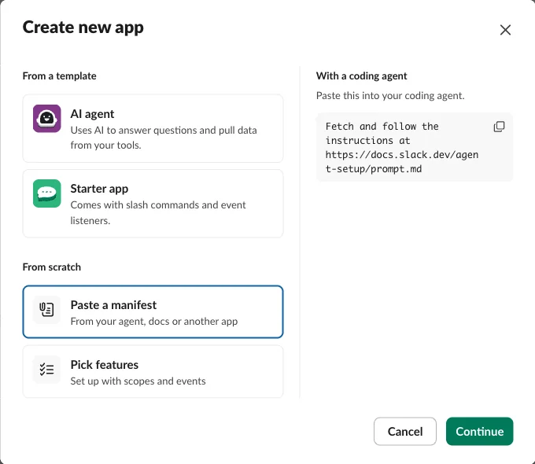

Replace the example manifest with the one below and pick the workspace that will host the bot. The workspace cannot be changed later.

```json
{
    "display_information": {
        "name": "Chatom Bot",
        "description": "A chat bot built with chatom"
    },
    "features": {
        "app_home": {
            "home_tab_enabled": false,
            "messages_tab_enabled": true,
            "messages_tab_read_only_enabled": false
        },
        "bot_user": {
            "display_name": "chatom-bot",
            "always_online": true
        }
    },
    "oauth_config": {
        "scopes": {
            "bot": [
                "app_mentions:read",
                "channels:history",
                "channels:join",
                "channels:read",
                "chat:write",
                "chat:write.public",
                "emoji:read",
                "files:read",
                "files:write",
                "groups:history",
                "groups:read",
                "im:history",
                "im:read",
                "im:write",
                "mpim:history",
                "mpim:read",
                "mpim:write",
                "reactions:read",
                "reactions:write",
                "users:read",
                "users:read.email",
                "users:write"
            ]
        }
    },
    "settings": {
        "event_subscriptions": {
            "bot_events": [
                "app_mention",
                "message.channels",
                "message.groups",
                "message.im",
                "message.mpim"
            ]
        },
        "interactivity": {
            "is_enabled": true
        },
        "org_deploy_enabled": false,
        "socket_mode_enabled": true,
        "token_rotation_enabled": false
    }
}
```

The scopes cover everything the Slack backend can do: reading and sending messages in public and private channels and direct messages, files, reactions, user lookups by email, and presence. Remove the ones your bot does not need.

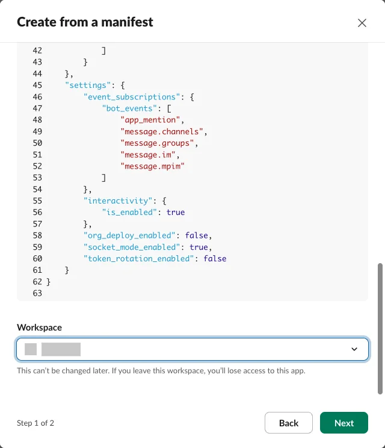

Select **Next**. The review should list 22 scopes and 5 events. Select **Create**.

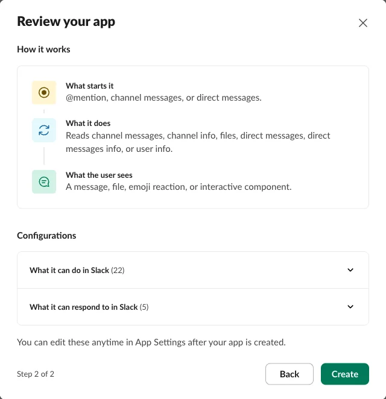

Slack opens the app's **Basic Information** page.

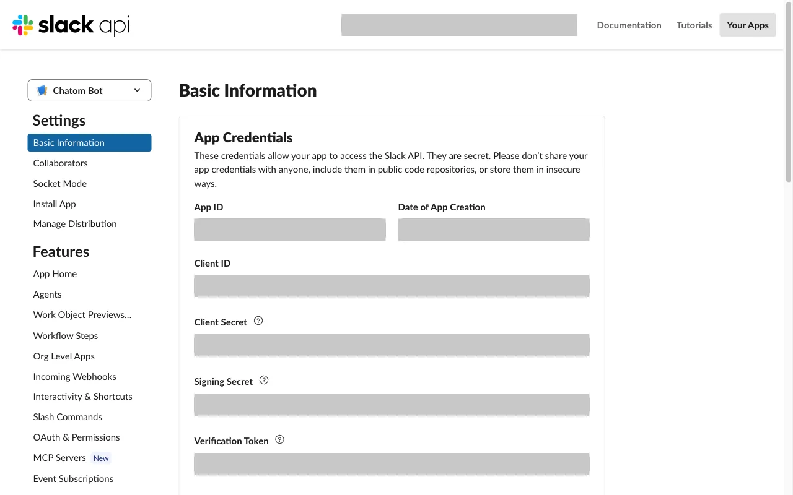

## Generate the app-level token

Socket Mode authenticates with an app-level token, which starts with `xapp-`. On **Basic Information**, scroll to **App-Level Tokens** and select **Generate Token and Scopes**.

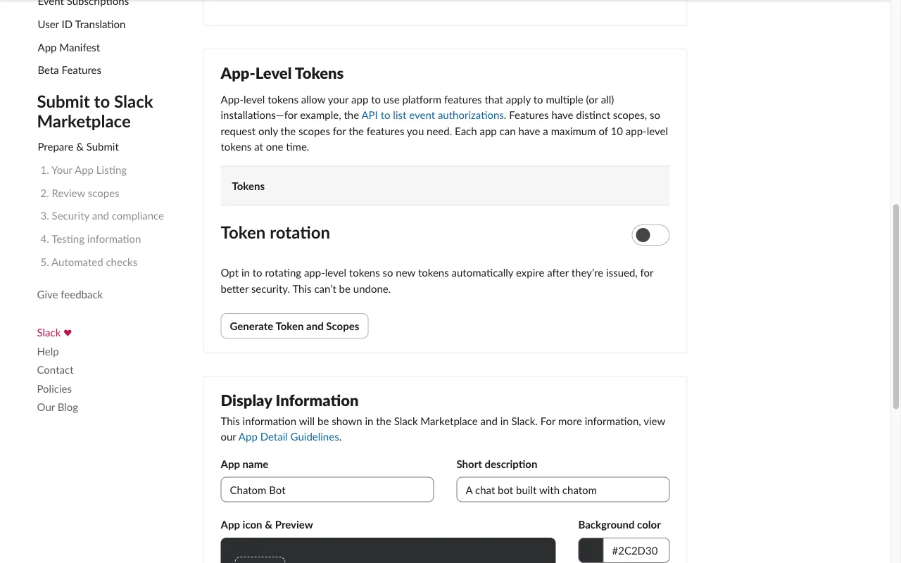

Name the token, for example `socket-mode`, and add the `connections:write` scope.

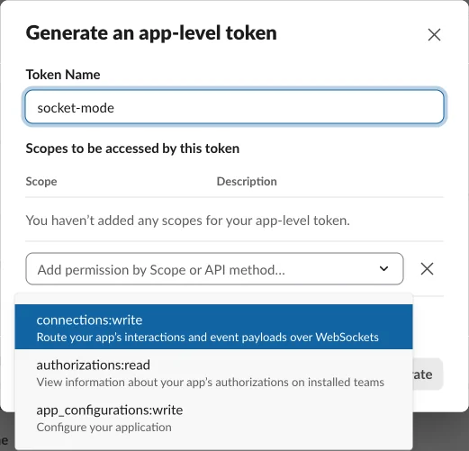

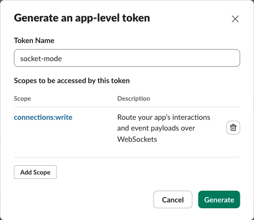

Select **Generate** and copy the token into your secret store. Slack shows it again on this page, but treat it like a password.

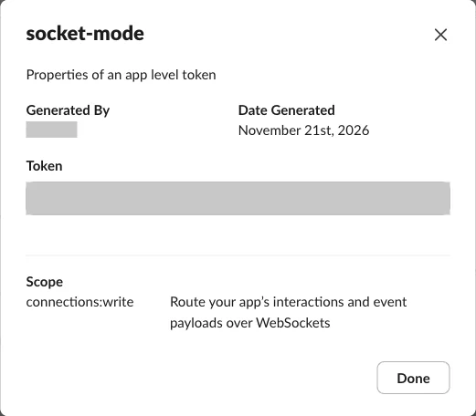

## Install the app and copy the bot token

Open **Install App** in the sidebar and select **Install to** your workspace.

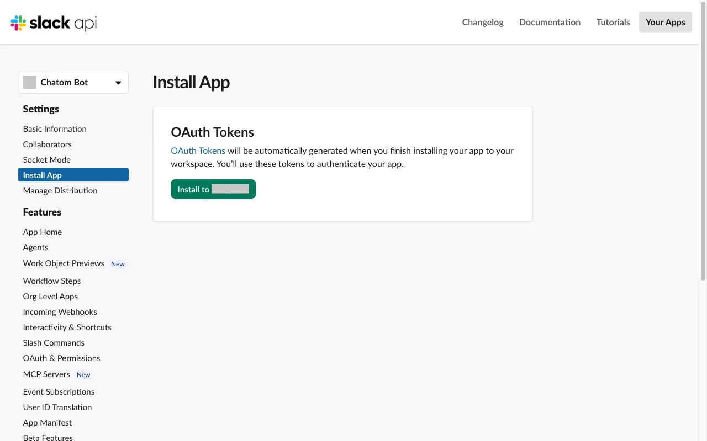

Review the permissions and select **Allow**.

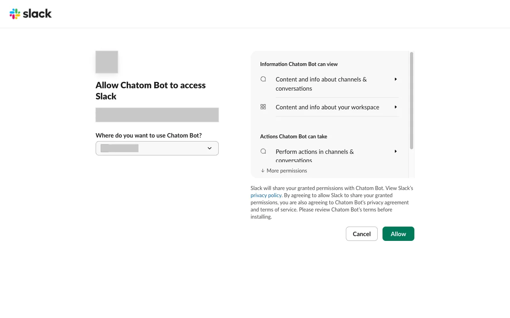

Slack returns to **Install App**, which now shows the **Bot User OAuth Token**. It starts with `xoxb-`. Copy it into your secret store.

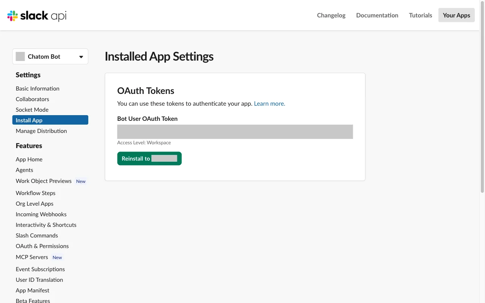

If you change scopes later, Slack asks you to reinstall the app before they take effect.

## Add the bot to a channel

The bot can post to public channels without joining them because of `chat:write.public`, but it only receives messages from channels it belongs to. Open the channel you will test in, select the channel name to open its details, and go to **Agents & apps** (called **Integrations** in some workspaces). Select **Add agents and apps**.

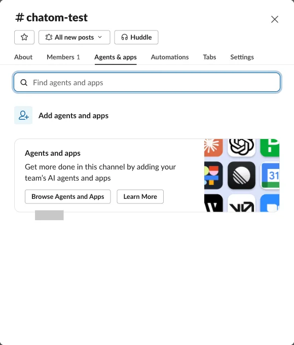

Search for `chatom-bot` and select **Add**.

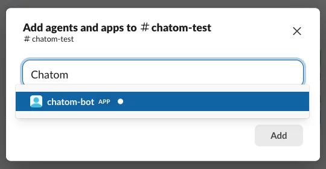

You can also type `/invite @chatom-bot` in the channel.

## Connect with Chatom

Install the Slack SDK and `aiohttp`, which Socket Mode needs:

```bash
pip install chatom slack-sdk aiohttp
```

Configure the backend with both tokens:

```python
import os

from chatom.slack import SlackBackend, SlackConfig

backend = SlackBackend(
    config=SlackConfig(
        bot_token=os.environ["SLACK_BOT_TOKEN"],
        app_token=os.environ["SLACK_APP_TOKEN"],
        socket_mode=True,
    )
)
```

Sending messages only needs `bot_token`. Listening for messages needs `app_token` and `socket_mode=True` as well.

## Check the setup

Chatom's examples read the same variables. Set them and run the examples from a shell:

```bash
export SLACK_BOT_TOKEN=xoxb-...
export SLACK_APP_TOKEN=xapp-...
export SLACK_TEST_CHANNEL_NAME=chatom-test

python -m chatom.examples.basic_connection --backend slack
python -m chatom.examples.send_message --backend slack
python -m chatom.examples.listen_for_messages --backend slack --timeout 60
```

`basic_connection` prints the backend's capabilities and the workspace name. `send_message` posts a greeting in the channel:

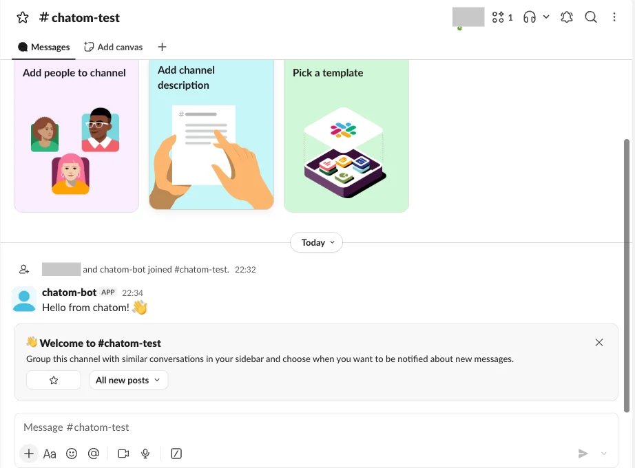

While `listen_for_messages` runs, send `!ping` in the channel. The bot answers with a quoted reply, and the example prints each message it receives.
