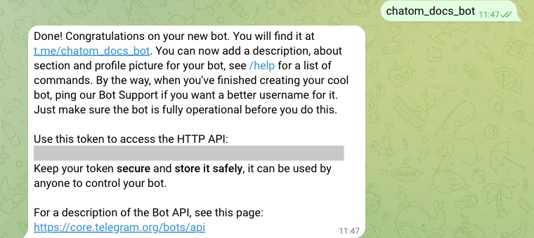
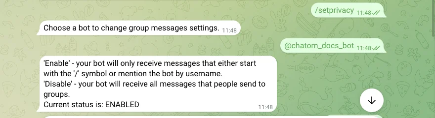
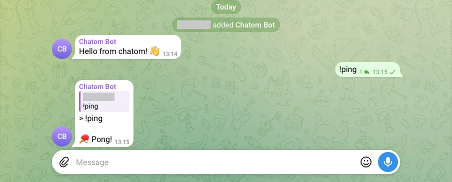

# Set up a Telegram bot

This guide creates a bot with BotFather, lets it read group messages, adds it to a group, and checks the connection with Chatom's examples. You need a Telegram account and a group you can add members to.

## Create the bot

Open a chat with [@BotFather](https://t.me/BotFather) and send `/newbot`. BotFather asks for a display name, then a username that ends in `bot`. Usernames are global, so try another if yours is taken.

BotFather replies with the bot's token. Copy it into your secret store. If the token leaks, send `/revoke` to BotFather to replace it.



## Turn off privacy mode

By default a bot in a group only receives commands that start with `/`, messages that mention it, and replies to its own messages. To let it read every message, send `/setprivacy` to BotFather, choose the bot, and select **Disable**.



Telegram applies the change to groups the bot joins afterward. If the bot is already in a group, remove it and add it again. A bot that is a group administrator receives every message whatever this setting says.

## Add the bot to a group

Open the group, select its name to open the group info, and add a member. Search for the bot's username and confirm.

## Find the chat id

Telegram has no API for looking up a private group by its title, so the examples need the group's numeric chat id. A public group can use its `@username` instead.

With no other program polling for the bot's updates, send a message in the group and run:

```bash
curl "https://api.telegram.org/bot$TELEGRAM_BOT_TOKEN/getUpdates"
```

The `chat.id` of the group's message is the chat id. Group ids are negative, and supergroup ids start with `-100`.

## Connect with Chatom

```bash
pip install chatom python-telegram-bot
```

```python
import os

from chatom.telegram import TelegramBackend, TelegramConfig

backend = TelegramBackend(config=TelegramConfig(bot_token=os.environ["TELEGRAM_BOT_TOKEN"]))
```

`fetch_channel(id=...)` takes the numeric chat id. `fetch_channel(name=...)` finds a public group by `@username`, and a private group by title only once the backend has cached it. `await backend.discover_chats()` caches every chat in the bot's pending updates.

## Check the setup

```bash
export TELEGRAM_BOT_TOKEN=...
export TELEGRAM_TEST_CHAT_NAME=-1001234567890   # or the group's public @username

python -m chatom.examples.basic_connection --backend telegram
python -m chatom.examples.send_message --backend telegram
python -m chatom.examples.listen_for_messages --backend telegram --timeout 60
```

`send_message` posts a greeting in the group. While `listen_for_messages` runs, send `!ping`, `!help`, or `!dm` in the group and the bot answers. A bot cannot start a private chat, so `!dm` only works after you have opened a chat with the bot and sent it `/start`.


