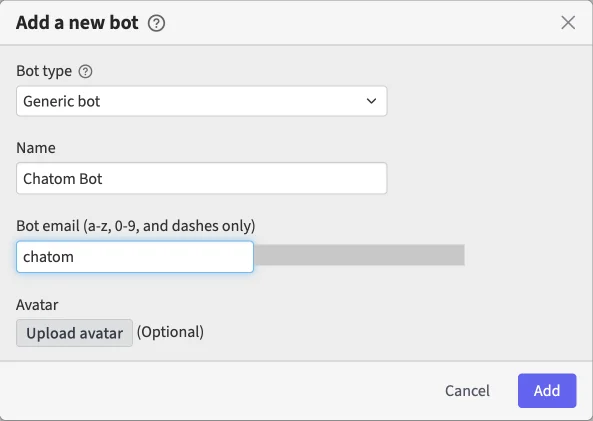
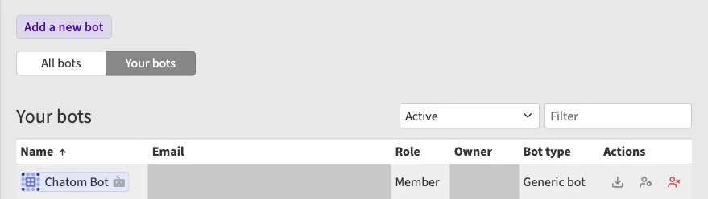
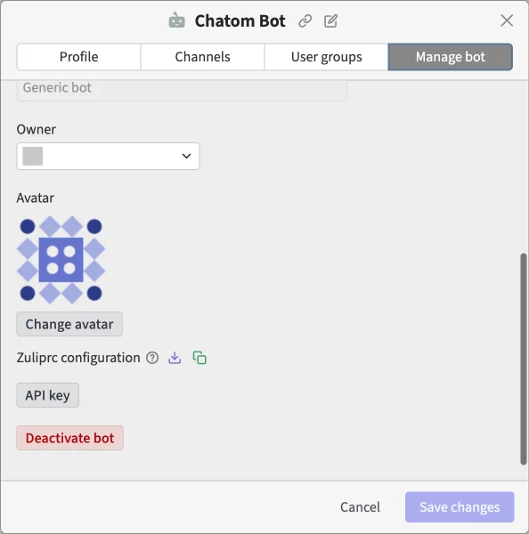
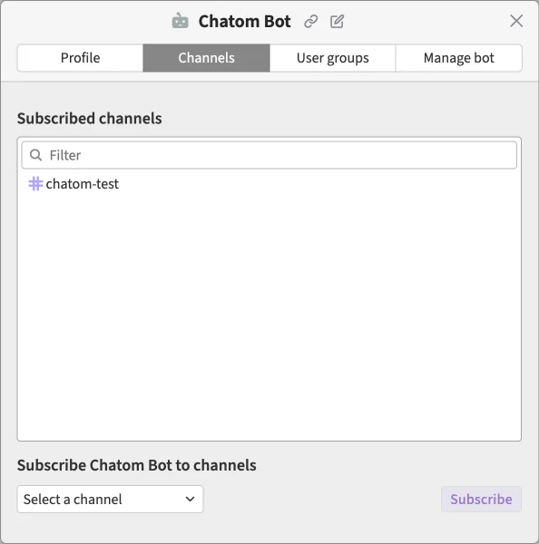
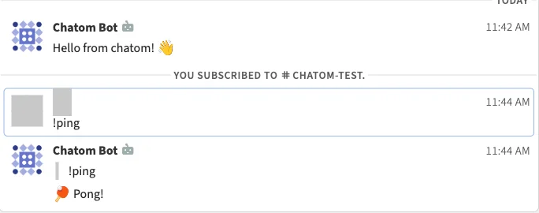

# Set up a Zulip bot

This guide creates a generic bot in a Zulip organization, subscribes it to a channel, and checks the connection with Chatom's examples. Any member can create a bot unless the organization's administrators have limited who may add bots.

## Create the bot

In Zulip, open **Personal settings** → **Bots** and select **Add a new bot**. Choose **Generic bot**, give it a name, and pick the start of its email address. Zulip adds `-bot` and the organization's domain to that name. Select **Add**.



The bot appears under **Your bots**.



## Get the API key

Select the bot's manage icon under **Actions** and open the **Manage bot** tab. Download the **Zuliprc configuration**, which contains the site, the bot's email, and its API key, or select **API key** to show the key on its own. Keep either one in your secret store.



## Subscribe the bot to channels

A bot only receives messages from channels it is subscribed to. Open the **Channels** tab, choose a channel under **Subscribe Chatom Bot to channels**, and select **Subscribe**.



## Connect with Chatom

```bash
pip install chatom zulip
```

Point the config at the downloaded zuliprc:

```python
from chatom.zulip import ZulipBackend, ZulipConfig

backend = ZulipBackend(config=ZulipConfig(config_file="/path/to/zuliprc"))
```

Or pass the values directly:

```python
import os

from chatom.zulip import ZulipBackend, ZulipConfig

backend = ZulipBackend(
    config=ZulipConfig(
        site="https://example.zulipchat.com",
        email="chatom-bot@example.zulipchat.com",
        api_key=os.environ["ZULIP_API_KEY"],
    )
)
```

When both are set, the zuliprc wins. Messages sent to a channel without a thread go to the `chatom` topic; change it with `default_topic`.

## Check the setup

Set either `ZULIP_CONFIG_FILE` or the three explicit values, plus the test channel, and run the examples from a shell:

```bash
export ZULIP_CONFIG_FILE=/path/to/zuliprc
# or: export ZULIP_SITE=... ZULIP_EMAIL=... ZULIP_API_KEY=...
export ZULIP_TEST_CHANNEL_NAME=chatom-test

python -m chatom.examples.basic_connection --backend zulip
python -m chatom.examples.send_message --backend zulip
python -m chatom.examples.listen_for_messages --backend zulip --timeout 60
```

`send_message` posts a greeting in the channel. While `listen_for_messages` runs, send `!ping`, `!help`, or `!dm` in the channel and the bot answers.


